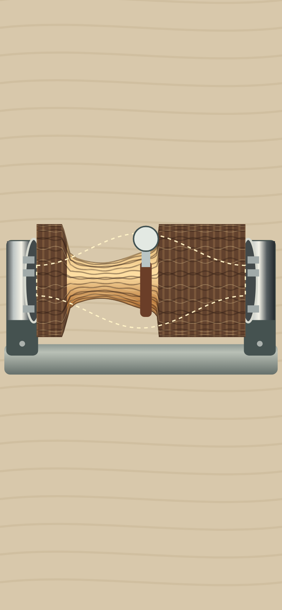
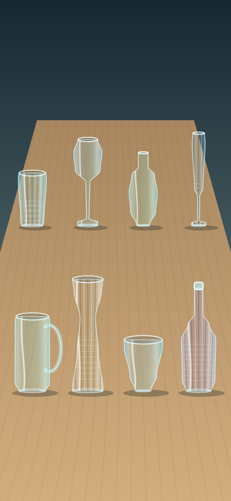

# No-No Stress

A pocket collection of satisfying fidget toys. Play with glowing particles, squish slime, carve wood, pop bubbles, and unwind at your own pace.

**[Download for Android](https://github.com/medissl/no-no-stress/releases/download/v0.6.0/No-No-Stress.apk)**

Free, offline, and ad-free. No account needed. Android 8 or newer.

## Gameplay

| Stardust | Slime | Wood carving |
| :---: | :---: | :---: |
|  |  |  |

| Liquid lava | Bubble pad | Glass break |
| :---: | :---: | :---: |
|  |  |  |

## Your own little toy box

Fourteen toys: Stardust, Liquid lava, Wood carving, Metal balls, Slime, Packaging pop, Zipper, On/off, Glass break, Little pond, Bubble pad, Slow dial, Sand, and Newton's cradle.

- Full-screen play with controls that fade out of the way.
- Bundled music, recorded sound effects, and optional haptics.
- Multitouch particle play and tilt controls for the metal balls.
- Separate music and sound-effect volume controls.

Tap Play, pick a toy, and enjoy. Tap near the top to reveal Back and Options.

<details>
<summary>Build locally</summary>

Node.js 20+:

```sh
npm ci
npm start
```

Open http://127.0.0.1:4173. Run `npm run check` and `npm test` for checks; browser checks use Playwright Chromium.

For Android, use JDK 21 and Android SDK Build Tools / Platform 35:

```powershell
./build-android.ps1 -BuildTools "$env:ANDROID_HOME/build-tools/35.0.0" -AndroidJar "$env:ANDROID_HOME/platforms/android-35/android.jar"
npm run check:apk
```

Keep the private signing key in `.local/` for app updates. APK downloads live in GitHub Releases.

</details>

[Music, sound, font, and source credits](CREDITS.md)
